# JavaScript & el Nuevo Stack de IA 🚀

Repositorio base y demostración práctica para la charla técnica: **"JavaScript & el Nuevo Stack de IA: De interfaces estáticas a aplicaciones web asistidas por Inteligencia Artificial"**.

---

## 📐 Gráfico de Arquitectura de la Solución

El proyecto implementa el patrón de arquitectura **Backend for Frontend (BFF)** con streaming en tiempo real mediante **Server-Sent Events (SSE)**:

```mermaid
flowchart LR
    subgraph Client["🖥️ CAPA CLIENTE (Browser SPA)"]
        direction TB
        UI["UI Conversacional<br/>(Tailwind CSS)"]
        Stream["Web Streams API<br/>(fetch + ReadableStream)"]
        Decoder["TextDecoder<br/>(Render Token a Token)"]
        XSS["Seguridad DOM<br/>(Prevención XSS)"]
    end

    subgraph BFF["⚙️ CAPA BFF (Node.js + TypeScript)"]
        direction TB
        Security["Auth & Rate Limiting<br/>(API Keys Ocultas)"]
        PromptEng["Gestión de Contexto<br/>(Prompt Guard)"]
        SSE["Transformador SSE<br/>(text/event-stream)"]
        LifeCycle["Detección Desconexión<br/>(req.close & Graceful)"]
    end

    subgraph AI["🧠 CAPA INFERENCIA (Modelo IA)"]
        direction TB
        Model["Modelo Cognitivo<br/>(Inferencia No Bloqueante)"]
        Tokens["Emisión de Tokens<br/>(Async Chunks)"]
    end

    Client -- "1. POST /api/chat { prompt }" --> BFF
    BFF -- "4. SSE Stream (text/event-stream)" --> Client
    BFF -- "2. SDK Call (Prompt enriquecido)" --> AI
    AI -- "3. Async Chunks (for await...of)" --> BFF

    style Client fill:#0f172a,stroke:#38bdf8,stroke-width:2px,color:#f8fafc
    style BFF fill:#0f172a,stroke:#818cf8,stroke-width:2px,color:#f8fafc
    style AI fill:#0f172a,stroke:#34d399,stroke-width:2px,color:#f8fafc
```



---

## ⏱️ Estructura de la Presentación (20 Minutos)

| Bloque / Slide | Tema | Minutos |
| :--- | :--- | :--- |
| **Slide 1** | Bienvenida, contexto y rol del Arquitecto | **0 - 2 min** |
| **Slide 2** | El cambio de paradigma: CRUD vs IA y el rol de JS | **2 - 4 min** |
| **Slide 3** | Anti-patrón vs Patrón BFF (Backend for Frontend) | **4 - 5.5 min** |
| **Slide 4** | **Arquitectura de la Solución**: Gráfico y Flujos End-to-End | **5.5 - 7 min** |
| **Slide 5** | UX y la importancia del streaming (TTFT) | **7 - 10 min** |
| **Slide 6** | Código Backend: Streaming con Express y Node.js | **10 - 12 min** |
| **Slide 7** | Código Frontend: Consumo nativo con Web Streams API | **12 - 14 min** |
| **Slide 8** | **Live Walkthrough**: Demostración técnica en vivo | **14 - 18 min** |
| **Slide 9** | 3 Takeaways, repositorio de código y Q&A | **18 - 20 min** |

---

## 🐳 Ejecución con Docker (Recomendado)

```bash
docker compose up -d --build
```
